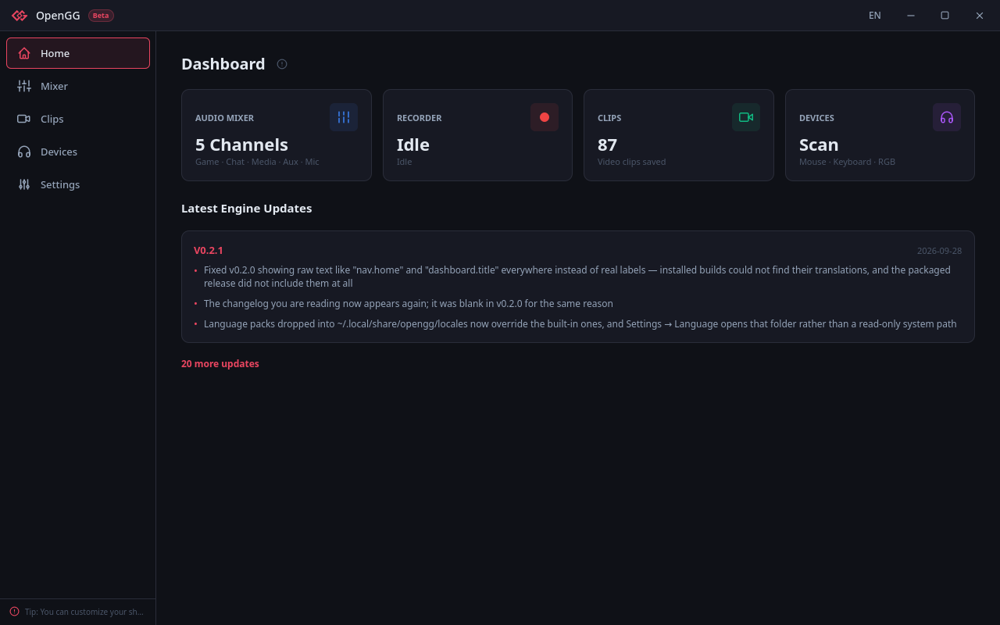
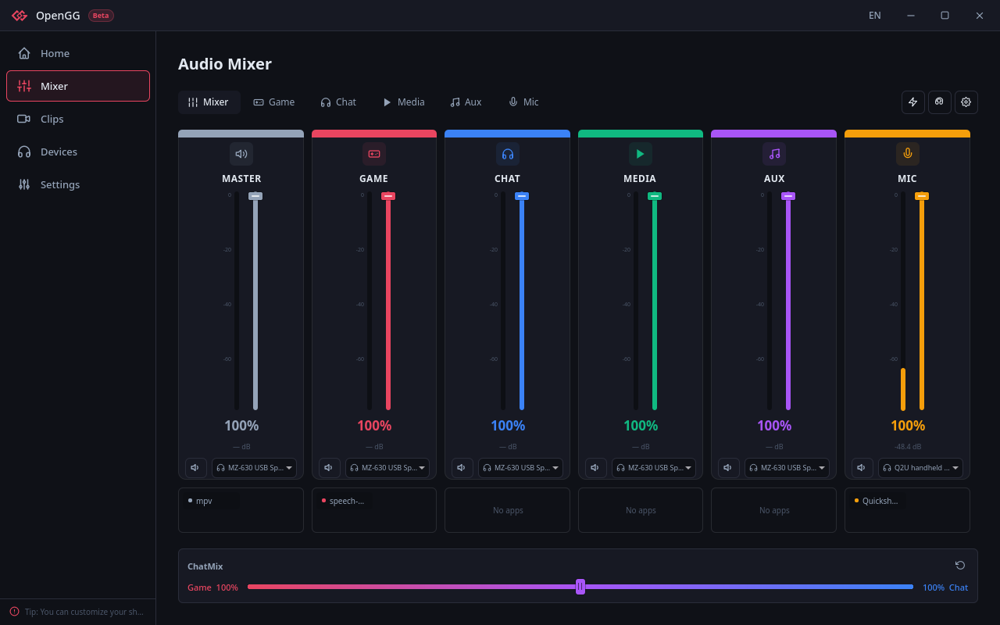
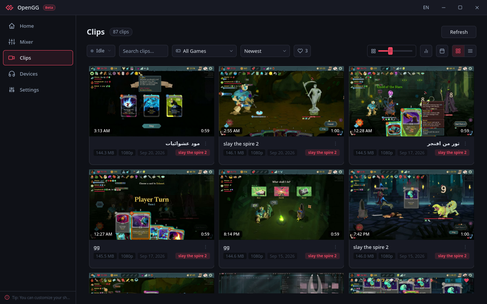
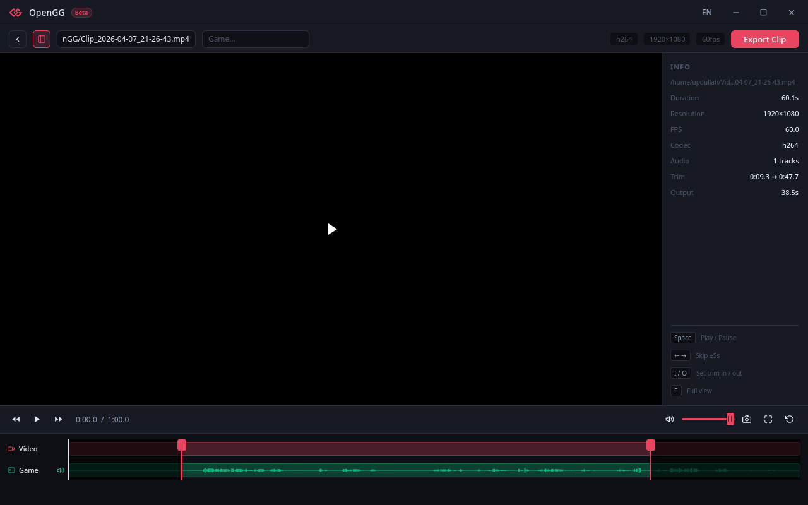
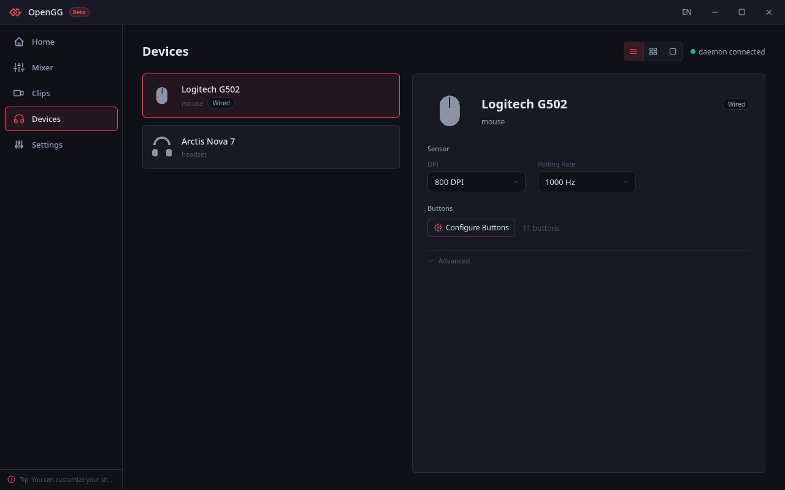
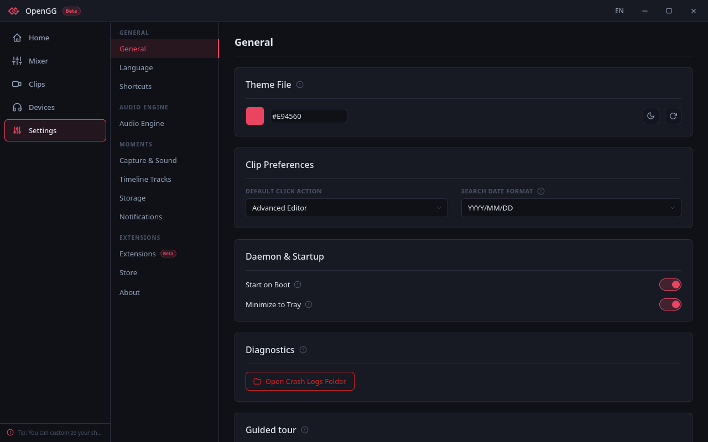

<p align="center">
  
</p>

<h1 align="center">OpenGG</h1>

<p align="center">
  <b>v0.2.3</b> · An open-source Linux gaming hub — audio mixer, device &amp; RGB manager, instant replay.<br/>
  A modular alternative to SteelSeries GG (Sonar + Engine + Moments).
</p>

---

## Screenshots

| Dashboard | Audio Mixer |
|---|---|
|  |  |

| Clips | Clip Editor |
|---|---|
|  |  |

| Devices | Settings |
|---|---|
|  |  |

## Install

**Arch / CachyOS** — installs the binary plus udev rules, D-Bus policy and systemd units:

```bash
yay -S opengg-bin
```

**From source** (any distro with Qt 6.7+ — install the packages under [Requirements](#requirements) first):

```bash
git clone https://github.com/UPdullah895/opengg.git
cd opengg
./dev.sh setup    # checks deps, data dirs + the `input` group (asks for your password once)
./dev.sh          # daemon + UI, unified logs
make install      # or install for real: ~/.local/bin + the daemon's user service
```

## Modules

- **Audio Hub** — 5-channel PipeWire mixer (Game / Chat / Media / Aux / Mic), per-app routing, 10-band EQ, ChatMix.
- **Device & RGB** — mouse DPI, polling rate and button mapping via ratbagd; headset controls; RGB via the OpenRGB SDK.
- **Clipping & Replay** — gpu-screen-recorder replay buffer, global hotkeys, clip gallery, multi-track editor with FFmpeg export.

## Requirements

Rust (stable, via [rustup](https://rustup.rs)) to build, and **Qt 6.7 or newer**. Ubuntu 24.04 and Debian 12 ship Qt 6.4 and are not supported natively. `./dev.sh deps` checks your machine and prints the install command for what is missing.

```bash
curl --proto '=https' --tlsv1.2 -sSf https://sh.rustup.rs | sh   # Rust, any distro
./dev.sh deps                                                     # what else is missing
```

**Arch / CachyOS**
```bash
sudo pacman -S --needed base-devel git curl cmake clang pkgconf \
    qt6-base qt6-declarative qt6-multimedia qt6-shadertools \
    gstreamer gst-plugins-base gst-plugins-good gst-plugins-bad gst-plugin-qml6 \
    pipewire-pulse wireplumber ffmpeg xdg-desktop-portal
yay -S gpu-screen-recorder
```

**Fedora**
```bash
sudo dnf install gcc gcc-c++ make cmake clang clang-devel pkgconf-pkg-config \
    qt6-qtbase-devel qt6-qtdeclarative-devel qt6-qtmultimedia-devel qt6-qtshadertools-devel \
    gstreamer1-devel gstreamer1-plugins-base-devel sqlite-devel mesa-libGL-devel \
    gstreamer1-plugins-good-qt6 gstreamer1-plugins-good gstreamer1-plugins-bad-free gstreamer1-plugin-libav \
    pipewire-pulseaudio pulseaudio-utils pipewire-utils qt6-qtwayland ffmpeg-free
```

**Debian 13+ / Ubuntu 26.04+**
```bash
sudo apt install build-essential cmake clang libclang-dev pkg-config \
    qt6-base-dev qt6-declarative-dev qt6-multimedia-dev qt6-shadertools-dev \
    libgstreamer1.0-dev libgstreamer-plugins-base1.0-dev libsqlite3-dev libgl1-mesa-dev \
    qml6-module-qtquick qml6-module-qtquick-controls qml6-module-qtquick-layouts \
    qml6-module-qtquick-window qml6-module-qtquick-templates qml6-module-qtquick-dialogs \
    qml6-module-qtquick-shapes qml6-module-qtmultimedia qml6-module-qt-labs-platform \
    qml6-module-qtqml-workerscript \
    gstreamer1.0-qt6 gstreamer1.0-plugins-good gstreamer1.0-plugins-bad gstreamer1.0-libav \
    qt6-wayland pipewire-pulse pulseaudio-utils ffmpeg
```

**openSUSE Tumbleweed**
```bash
sudo zypper install gcc gcc-c++ make cmake clang pkgconf-pkg-config \
    qt6-base-devel qt6-declarative-devel qt6-multimedia-devel qt6-shadertools-devel \
    gstreamer-devel gstreamer-plugins-base-devel sqlite3-devel Mesa-libGL-devel \
    qt6-multimedia-imports gstreamer-plugins-good-qtqml6 gstreamer-plugins-good \
    gstreamer-plugins-bad gstreamer-plugins-libav \
    pipewire-pulseaudio pulseaudio-utils ffmpeg
```

Clip recording also needs [`gpu-screen-recorder`](https://git.dec05eba.com/gpu-screen-recorder/about/) (NVENC on NVIDIA, VAAPI on AMD / Intel), installed from your distro or its upstream.

## Development

| Command | What it does |
|---|---|
| `./dev.sh` | Daemon + UI with unified logs |
| `./dev.sh daemon` / `./dev.sh ui` | One half only |
| `./dev.sh build` | Release build |
| `make install` | Install to `~/.local/bin` + locales to `~/.local/share/opengg` |
| `make lint` | clippy + `check-colors.sh` |

The three crates — `daemon/`, `core/`, `qt-shell/` — are built independently; there is no Cargo workspace. The Qt shell links `opengg-core` and reaches `openggd` over D-Bus.

Working on the UI? Read [`AGENTS.md`](AGENTS.md) first — it carries the QML landmines and the mandatory pre-commit checks. See also [`CONTRIBUTING.md`](CONTRIBUTING.md), [`docs/EXTENSION_DEV.md`](docs/EXTENSION_DEV.md) and [`docs/TRANSLATING.md`](docs/TRANSLATING.md).

## Data locations

| Data | Path |
|---|---|
| Daemon config | `~/.config/opengg/daemon.toml` |
| UI settings / theme | `~/.config/opengg/ui-settings.json`, `theme.json` |
| Clips DB + thumbnails | `~/.local/share/opengg/` |
| Default clips dir | `~/Videos/OpenGG/` |
| Extensions | `~/.local/share/opengg/extensions/` |
| Language packs | `~/.local/share/opengg/locales/` |
| Crash log | `~/.local/share/opengg/opengg_crash.log` |

## Troubleshooting

**Clip playback stalls** — install `gst-plugin-qml6` (runtime only).

**Global hotkeys do nothing** — they read `/dev/input` directly, which needs the `input` group. `./dev.sh setup` adds you; log out and back in.

**No virtual sinks / routing fails** — check you are in the `audio` group and that `systemctl --user status pipewire wireplumber` are running. **Settings → Danger Zone → Remove Virtual Audio** resets routing.

## Security model

No sudo at runtime — the daemon is unprivileged and gets what it needs from the `audio`, `input` and `video` groups. It auto-activates over D-Bus rather than being launched by hand.

## License

MIT
